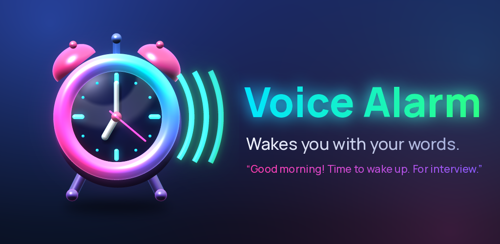

# Voice Alarm 🔊⏰



An Android alarm clock that **speaks the label you set**. Set an alarm for 7:00 AM
labelled **"for interview"** and, instead of a beep, a natural voice wakes you
up saying:

> *(soft chime)* "Good morning, Purnendu! Time to wake up. For interview."

The message repeats with a short pause and grows louder gently. It sounds like
a person waking you up, not a siren.

## Download the APK

Every push builds the app on GitHub Actions and publishes it as the
**`latest` release**:

1. On your phone, open
   **https://github.com/purnendukumarghosh/android-alarm/releases/latest**
2. Download **`VoiceAlarm.apk`** and tap it.
3. If asked, allow "Install unknown apps" for your browser or file manager.

## Screenshots

Rendered automatically by CI (Robolectric) from the latest commit; see the
[`screenshots` release](https://github.com/purnendukumarghosh/android-alarm/releases/tag/screenshots).

| Alarms | Drawer | Editor | Ringing |
| --- | --- | --- | --- |
|  |  |  |  |

| Quick nap | Voice studio | Settings | About us |
| --- | --- | --- | --- |
|  |  |  |  |

## Design: "Neon Night" 3D

A dark, premium look: deep navy space lit by neon glows (cyan, green, red,
magenta, blue and violet), with:
- glass cards that have lit rims and soft shadows,
- glossy beveled buttons that sink when pressed,
- glass-sphere switches and a floating 3D dock.

Everything is drawn in code, so it stays sharp on every screen:
- The hamburger drawer tilts the app back in 3D when it opens.
- The ringing screen has a live 3D clock inside pulsing neon rings.
- The app icon and illustrations are rendered procedurally by
  [`tools/art/render_art.py`](tools/art/render_art.py).

The design system is documented in
[`docs/design-system.md`](docs/design-system.md).

## Features

- **Speaks your label**: natural text-to-speech voices read out what each
  alarm is for, optionally greeting you by name and saying the time.
- **Your own voice**: record yourself, or someone you love, instead.
- **Voice studio**: pick the default voice (with previews), speaking speed,
  your name, and try any phrase.
- **Quick nap**: one tap for a 10 to 90 minute nap that tells you why it's
  ringing.
- **Works offline**: the voice is prepared when you save, so it rings without
  internet. If anything fails it speaks live, and as a last resort plays your
  normal alarm sound. It never stays silent.
- Repeat days, snooze length, vibration, a gentle volume ramp and ring
  duration.
- Full-screen ringing screen over the lock screen, with slide to dismiss.
- A reliability checklist (notifications, exact alarms, full-screen alerts,
  battery) with one-tap fixes.
- Alarms survive reboots, time-zone changes and app updates (`setAlarmClock`
  rings on time even in Doze).

## Making it sound human

The app ranks the voices on your phone. It prefers your language and accent
(for example English (India)), then HD and online neural voices. You can try
every voice in **Voice studio**. For the most natural voices, install or
update **Speech Services by Google** from the Play Store, then download the HD
voices for your language in *Settings › Text-to-speech*.

On Xiaomi, Oppo, Vivo, Realme and some Samsung phones, open
*Settings › Apps › Voice Alarm › Battery*, choose **No restrictions**, and
enable **Autostart** if it exists.

## About us

Created by **Purnendu Kumar Ghosh**:
[LinkedIn](https://www.linkedin.com/in/purnendu-ghosh-b217161b4)

## Building it yourself

Requirements: JDK 17 and the Android SDK (API 34).

```bash
./gradlew assembleRelease          # app/build/outputs/apk/release/app-release.apk
./gradlew testDebugUnitTest        # screenshot tests -> app/build/screenshots/
python3 tools/art/render_art.py    # re-render icon + illustrations (numpy, Pillow)
```

### Signing

Without extra setup the APK is signed with a debug key that changes on every CI
run. When you install a newer build you may then need to uninstall the old one
first, which also deletes your alarms. To keep the same key, create a keystore
once and add these repository secrets (*Settings › Secrets and variables ›
Actions*): `SIGNING_KEYSTORE_BASE64` (`base64 -w0 my.jks`),
`SIGNING_STORE_PASSWORD`, `SIGNING_KEY_ALIAS`, `SIGNING_KEY_PASSWORD`.

## Credits

- [Manrope](https://github.com/sharanda/manrope) font: SIL Open Font
  License 1.1 (`licenses/Manrope-OFL.txt`)
- [Material Symbols](https://github.com/google/material-design-icons):
  Apache License 2.0
- LinkedIn logo from [Simple Icons](https://simpleicons.org): CC0. LinkedIn is
  a trademark of LinkedIn Corporation.
